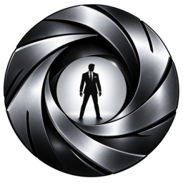
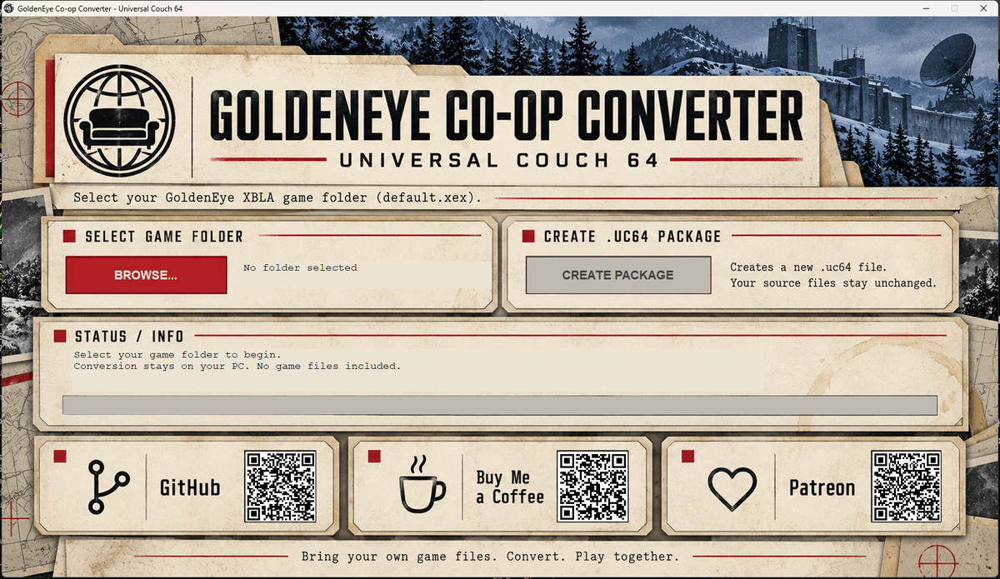
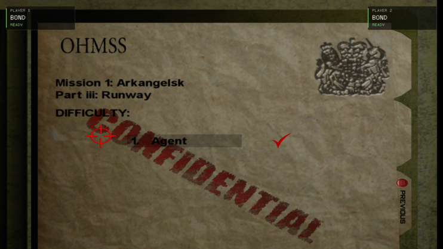
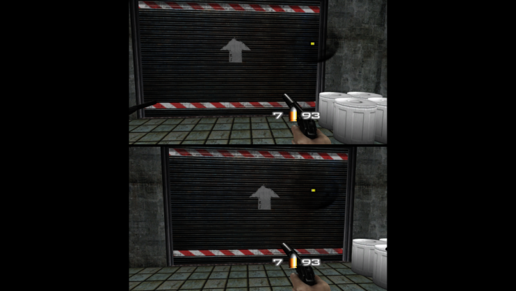
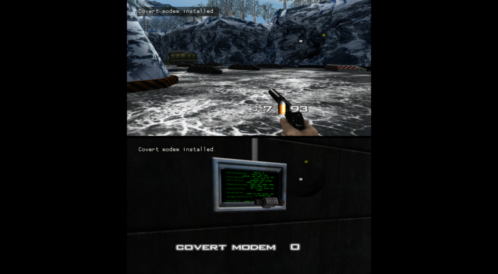
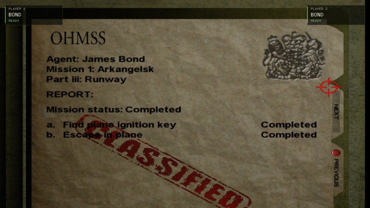

  

<h1 align="center">GoldenEye XBLA Co-op Converter</h1>

<b>Two agents. One mission.</b>

A fan-made two-player co-op campaign for the <i>GoldenEye 007</i> Xbox Live Arcade version, 
played through <b>Universal Couch 64 (UC64)</b>. Bring your own game files.

## Download

**[Download GoldenEye Co-op Converter v0.1.0 for Windows](https://github.com/SzebaHUN/goldeneye-xbla-coop-converter/releases/tag/v0.1.0)**

Download `GoldenEye-Coop-Converter.exe` (and optionally `SHA256SUMS.txt`) from **Assets**.
Do not download GitHub's automatically generated "Source code" archives.

> [!IMPORTANT]
> **UC64-exclusive build. Playing requires Universal Couch 64 0.6.3 or later.**
> The converter runs offline and does not need UC64 installed. It builds the co-op GoldenEye runtime **on your PC
> from your own game files** and puts it in the `.uc64` package, so UC64 needs nothing else installed. UC64 only
> starts a runtime that is byte-for-byte the approved build. Remote players only need UC64 (no game files).
>
> **[⬇ Download Universal Couch 64](https://github.com/SzebaHUN/universal-couch/releases)**.
> UC64 0.6.2 and older do **not** support this package.

> [!WARNING]
> **Experimental release.** The two-player campaign works, but the whole campaign has not been played start to finish
> in co-op, and several issues are still open (see [Known issues](#known-issues)). Three- and four-player co-op can be enabled when the host assigns the additional participants as Players rather than Watchers. These modes are experimental and have not been validated; two-player co-op is the tested configuration.

> [!NOTE]
> **No game files are included.** You need your own copy of the GoldenEye 007 XBLA game files.

---

## What is it?

This project lets **two players play the GoldenEye 007 campaign together**, in the same mission, at the same time.

- Both players are in **one game**: one level, one set of guards, one set of objectives, one mission result.
- Each player has their **own split-screen view** of that game.
- The host runs the game on their Windows PC through **Universal Couch 64**; the second player joins the host's UC64
  room.

This repository publishes the **converter**: a small Windows program that packages your own, complete, extracted
GoldenEye XBLA game folder (the folder containing `default.xex`) into a `.uc64` game package that UC64 can install.

The converter does **not**:

- convert an N64 ROM (this is the Xbox Live Arcade version, not the N64 cartridge),
- create a standalone game `.exe`,
- download, include or modify any game files.

The only supported way to play is through UC64.

## Features

- **Two-player campaign co-op** in the original missions, with a split-screen view per player.
- **Player views in UC64.** A remote player can watch the whole picture or just their own view.
- **Shared mission items.** A mission item either player is carrying counts for the team, so objectives such as
  *Find plane ignition key* complete no matter who holds it.
- **Mission tools for both players.** Gadgets such as the covert modem can be selected by either player (see
  [Controls](#co-op-controls)).
- **Objectives in the pause menu.** Each player can open the pause menu to see the mission objectives and their status.
- **Revive.** A downed player can be revived by their teammate (see [Revive](#revive)).
- **Mission messages per player.** Pickup, objective and mission messages appear at the top of each player's own view.
- **Host-owned saving and progression.** See below.

## Host and Player 2

**Player 1 / host** owns the game:

- runs UC64 and the game on their PC
- owns the game files, the `.uc64` package and the save
- controls the menus, mission and difficulty selection
- campaign progress is saved on the host PC only

**Player 2** is a co-op agent in the same mission:

- presses **START** on the title/menu screen to join (the corner card shows *READY*)
- can also press menu buttons, but cannot take the menus away from Player 1
- does not have a separate campaign or save, and does not need the game files

## Requirements

| | |
|---|---|
| **OS** | Windows 10 or 11 (64-bit) |
| **Converter** | `GoldenEye-Coop-Converter.exe`, one file (about 90 MB); works offline; nothing to install (uses the .NET Framework built into Windows). It contains its own build tools (LLVM/MinGW) and the co-op runtime, but no game code |
| **Game files** | Your own complete, extracted GoldenEye 007 XBLA game folder: `default.xex`, `ArcadeInfo.xml` and the `files` folder with all its assets and audio |
| **Supported `default.xex`** | SHA-256 `038a3808477da4a3644d634aacac63b9c19e913b77dffcc22960fb6780f93c04` (other builds are rejected) |
| **To play** | **[Universal Couch 64](https://github.com/SzebaHUN/universal-couch/releases) 0.6.3 or later** on the host and on every remote player's PC |
| **Free disk space** | About 0.4 GB for the converter's build tools (unpacked once), 0.8 GB for the `.uc64` package, plus the same again when UC64 installs it |

This project does not provide game files or download links for them. Please don't ask for them in issues.

## Setup

1. **Download** `GoldenEye-Coop-Converter.exe` from the [release Assets](https://github.com/SzebaHUN/goldeneye-xbla-coop-converter/releases/tag/v0.1.0).
   It is a single file; there is no archive to extract and no companion file to keep.
2. Have your GoldenEye 007 XBLA game folder **extracted** on your PC: the folder that contains `default.xex`,
   `ArcadeInfo.xml` and the complete `files` folder (all assets and audio).
3. Run `GoldenEye-Coop-Converter.exe`. Click **BROWSE...** and select that folder.
   (You can also drag the folder onto the window.)
4. The status box says whether the folder is valid. **CREATE PACKAGE** is only enabled for a supported, complete folder;
   otherwise it explains what is wrong.
5. Click **CREATE PACKAGE** and choose where to save `GoldenEye 007 Co-op.uc64`. You are asked before an existing file
   is replaced. The converter then builds the game runtime from your files and writes the package; a progress bar
   shows it (about 1–5 minutes, plus a one-time unpack of its build tools). Your game folder is not changed.
6. When it says **Done**, **OPEN OUTPUT FOLDER** shows the new file.
7. Install **[Universal Couch 64](https://github.com/SzebaHUN/universal-couch/releases) 0.6.3 or later** (everyone who plays).
8. In UC64: **Host Game** → choose (or drop) `GoldenEye 007 Co-op.uc64`. UC64 checks the package and its runtime and
   installs it the first time.
9. Host a room. Player 2 joins with the room code in UC64. The host makes them a player and presses **START GAME**.
10. On the title screen, Player 2 presses **START** to join. Player 1 picks the mission and difficulty.

The converter keeps a helper copy of its packaging backend in `%TEMP%\UC64-GoldenEye-Converter` while it works;
it is safe to delete.

**Windows SmartScreen:** the `.exe` is not code-signed, so Windows may warn on first launch. Click *More info*, then
*Run anyway*. You can check the file against `SHA256SUMS.txt` from the release.

The `.uc64` package contains your own game files. Keep it for yourself; never share or upload it.

## Co-op controls

Controls are the normal GoldenEye XBLA controls for each player (Xbox-style controller), plus:

| Action | Button |
|---|---|
| **Switch weapon** | Tap **Y** (the switch happens when you release Y) |
| **Select a mission tool / gadget** | **Hold Y for about 3 seconds**. The next mission tool you carry is equipped and its name is shown in your view. Keep holding to step to the next tool about once per second. Tap Y to go back to weapons. |
| **Use a mission tool** | As in the original game, e.g. fire (**RT**) to throw/place the selected tool |
| **Revive a downed teammate** | Stand right next to them and **hold X for 4 seconds** |
| **Mission objectives** | Open the pause menu |
| **Join (Player 2)** | **START** on the title/menu screen |

In co-op there is no Q-Watch inventory screen, which is why mission tools are selected by holding Y.

## Revive

- When a player takes lethal damage while their teammate is still alive, they are **downed** instead of killed:
  they crouch, cannot move or act, take no further damage and keep their items.
- The teammate revives them by standing **right next to them** and **holding X for 4 seconds**. A progress ring
  shows in both players' views.
- Progress resets if X is released, the reviver moves out of range, or the reviver goes down.
- A revived player comes back with **half health**.
- If **both** players are down, the mission fails.

Revive is implemented as described, but it was not re-tested during this release's test round.

## Screenshots

The converter screenshot above is the actual program. The gameplay screenshots below are real captures of the game
running through UC64 on Windows (two-player split screen), with the **game imagery deliberately blurred**; the captions
describe what each one shows.

<i>Blurred: mission briefing (Runway) with both players joined; the corner cards show each player's state.</i>

<i>Blurred: two players in the same mission, one view each (top and bottom).</i>

<i>Blurred: Dam — each player holds Y to select the covert modem; the tool name appears at the top of that player's view.</i>

<i>Blurred: Dam — Player 2 installs the covert modem; the mission message appears inside both players' views.</i>

<i>Blurred: Runway mission report after completing it in co-op through the normal menus.</i>

## Tested so far

On two Windows laptops over a home network with UC64 (one host, one remote player), unless noted:

- Runway played through the normal menus to the mission report (*Completed*), saved, and still unlocked after a restart.
- Player 2 pressing START first does not take the menus away from Player 1.
- Covert modem selected with hold-Y and installed by the remote Player 2 (Dam, 00 Agent).
- Surface: the co-op fog/black-scenery problem is fixed.
- Converter: invalid folders rejected, valid folder accepted, package created, imported into UC64 and launched (host PC).
- Mission messages inside each player's view: checked on the host PC only.

## Known issues

- **Frigate:** the mission can end early (failed) if one player goes back to the boat while the other has left it.
  No verified workaround yet; if it happens, replay the mission from the menu.
- **Mission ending camera:** at the end of a mission, the exit "fly-out" plays in only one player's view; the other view
  stays static and the other player can appear dragged towards the exit. It does not affect the mission result.
- **Kill counter:** a multiplayer-style kill counter can appear in co-op. It has not been removed yet.
- **Performance:** while UC64 streams the game, the game currently runs at about 33–35 fps on our test PC
  (about 50 fps without streaming).
- **Not yet verified:** the GoldenEye key / key copy (Bunker), Frigate bomb defusers, Silo plastique, Train watch laser,
  Aztec guidance data, the watch magnet, the Facility door decoder and the bonus missions; the pause-menu objectives
  panel; the converter's drag-and-drop (Browse is verified).
- **Three or four players:** Three- and four-player co-op can be enabled when the host assigns the additional participants as Players rather than Watchers. These modes are experimental and have not been validated; two-player co-op is the tested configuration.
- **Version lock:** packages need UC64 0.6.3 or later on the host and remote players' PCs; packages made with
  converter v0.1.0 must be made again with this converter.
- The converter is Windows-only and not code-signed.

## Reporting bugs

Please [open an issue](https://github.com/SzebaHUN/goldeneye-xbla-coop-converter/issues/new/choose) and include:

- **Mission** and **difficulty**
- **What Player 1 was doing** and **what Player 2 was doing**
- **What happened** and **what you expected**
- **Local or remote** Player 2, and both players' **UC64 version** (0.6.3 or later)
- **Converter version** (v0.1.0) for converter problems, and the exact message it showed
- A **screenshot or short video**, if you have one

Please don't attach game files, `.uc64` packages or save files to issues.

## Credits

- ***GoldenEye 007*** was created by **Rare** (Nintendo 64, 1997). The Xbox Live Arcade version was developed by
  **4J Studios** with Rare. All credit for the original game goes to its creators.
- **GoldenEye co-op, the converter and Universal Couch 64:** **SzebaHUN**.
- The Windows GoldenEye runtime is a static recompilation of the XBLA game (ReXGlue). The converter generates and
  compiles the game-specific part on your PC from your own `default.xex`; the converter itself contains no game code.
- The converter bundles open-source components; see [THIRD_PARTY_NOTICES.md](THIRD_PARTY_NOTICES.md).

This is an independent fan project. It is not affiliated with, endorsed by or connected to Rare, Microsoft, Nintendo,
4J Studios, MGM, Danjaq, EON Productions or any other rights holder.

## Support

The converter and the co-op mod are free. Support is completely optional and helps fund further development and testing.

- [Buy Me a Coffee](https://buymeacoffee.com/szebahun)
- [Patreon](https://www.patreon.com/cw/SzebaHUN)
- [More projects on GitHub](https://github.com/SzebaHUN?tab=repositories)

## Disclaimer

- This is an unofficial fan-made project. *GoldenEye 007*, *James Bond* and related names are trademarks of their
  respective owners.
- **No game files are included or distributed.** The converter only packages files you already have, on your own PC.
- You must provide your own copy of the supported game files.
- Experimental software, provided as-is with no warranty. Keep a backup of your saves.
